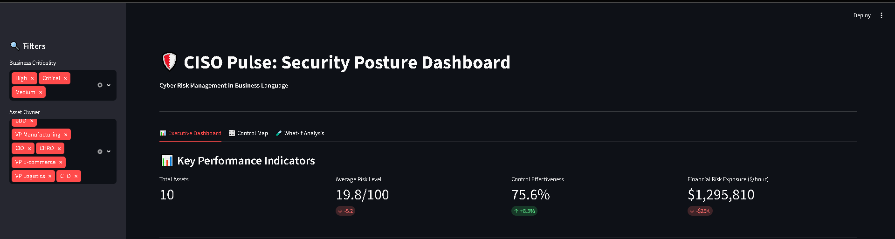
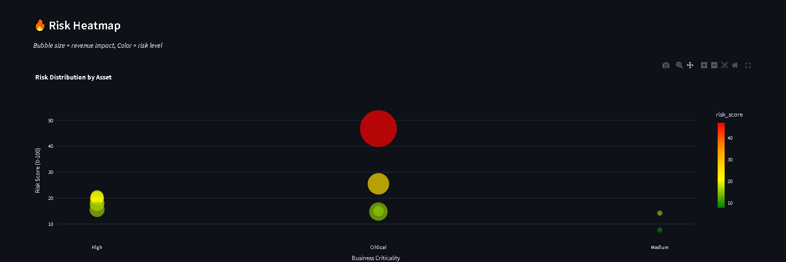
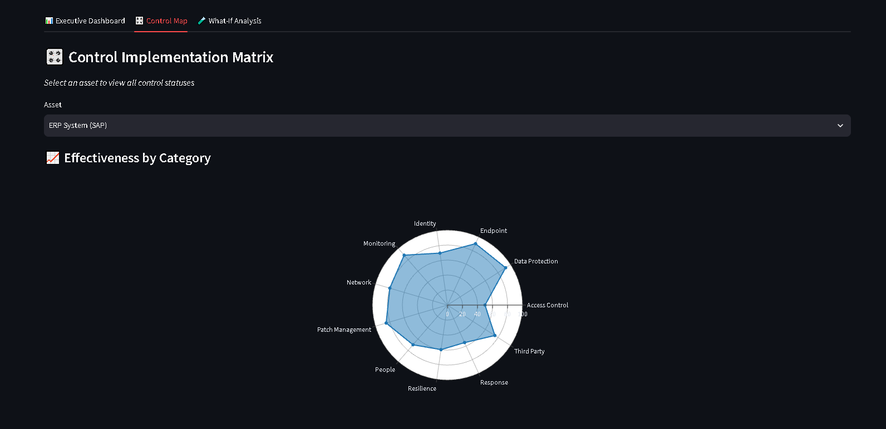

# 🛡️ CISO Pulse

### Security Posture Dashboard for Modern CISOs

<div align="center">

[](https://www.python.org/downloads/)
[](https://streamlit.io)
[](https://opensource.org/licenses/MIT)
[](https://github.com/psf/black)
[](http://makeapullrequest.com)

**Transform technical security metrics into business language in 5 minutes.**

[Demo](#-demo) • [Quick Start](#-quick-start) • [Methodology](#-methodology) 

</div>

---

## 🎯 The Problem

Traditional security tools (SIEM, vulnerability scanners, EDR) generate **thousands of technical alerts**, but fail to answer the key question from leadership:

> **"How protected are our critical business assets and what will their compromise cost?"**

CISOs spend **days** preparing reports for the Board of Directors, gathering data from 5-10 different systems into Excel. The result — an outdated 40-slide presentation that nobody reads.

## 💡 The Solution

**CISO Pulse** is a lightweight dashboard that transforms scattered technical metrics into a **unified business risk panel** using a simplified FAIR methodology.

### Key Features

✅ **Crown Jewels Registry** — centralized catalog of business services with owners  
✅ **Security Control Map** — mapping of technical controls to business assets  
✅ **Business Risk Calculator** — automatic risk calculation based on criticality and protection level  
✅ **Executive Dashboard** — risk visualization without technical jargon  
✅ **What-If Simulator** — budget justification tool with ROI calculation  
✅ **Report Generator** — one-page PDF for the Board of Directors in 1 click  

---

## 🎬 Demo

### Executive Dashboard



*Main dashboard with risk heatmap and KPIs*

### Control Map



*Radar chart of control effectiveness by category*

### What-If Analysis



*Security investment simulator for CFO meetings*

### Use Case Example

**Scenario**: CFO asks: *"How much do we need to invest in security next quarter?"*

**Without CISO Pulse**:
- 3 days of manual Excel work
- Data collection from 5 systems
- 40-slide presentation
- Result: budget cut by 30%

**With CISO Pulse**:
- 5 minutes of work
- Open dashboard, see risk heatmap
- Generate PDF with specific numbers
- Result: *"Investment of $2.5M will reduce ERP downtime risk by 67%, equivalent to saving $16M annually"*
- **Budget approved**

---

## 🚀 Quick Start

### Requirements

- Python 3.10+
- pip

### Installation

```bash
git clone https://github.com/yourusername/ciso-pulse.git
cd ciso-pulse

python -m venv venv
source venv/bin/activate        # Linux/Mac
venv\Scripts\activate           # Windows

pip install -r requirements.txt
```

### Launch

```bash
streamlit run app/dashboard.py
```

Open browser at: `http://localhost:8501`

### Docker (optional)

```bash
docker build -t ciso-pulse .
docker run -p 8501:8501 ciso-pulse
```

---

## 🏗 Architecture

```
ciso-pulse/
├── app/
│   ├── dashboard.py            # Streamlit UI
│   ├── risk_engine.py          # FAIR-based risk calculation
│   └── report_generator.py     # PDF report generation
├── data/
│   ├── assets.csv              # Critical assets registry
│   ├── controls.csv            # Security controls catalog
│   └── asset_controls.csv      # Control implementation matrix
├── requirements.txt
└── README.md
```

### Key Components

| Module | Responsibility |
|--------|----------------|
| `dashboard.py` | Streamlit UI with 3 tabs: Executive Dashboard, Control Map, What-If Analysis |
| `risk_engine.py` | FAIR-based risk calculation: `Risk = Criticality × (100 - Effectiveness)` |
| `report_generator.py` | Professional PDF generation with matplotlib heatmaps and fpdf2 |

---

## 📊 Methodology

CISO Pulse is based on **risk management principles**, not technical metrics.

### 1. Asset Criticality (Business Impact)

| Level | Description | Example |
|-------|-------------|---------|
| **Critical** | Business stoppage >4 hours | ERP, Production SCADA |
| **High** | Serious financial/reputational losses | CRM, Financial System |
| **Medium** | Temporary inconvenience | Corporate Email, HR Portal |
| **Low** | Minimal impact | Internal Wiki |

### 2. Control Effectiveness

Based on CIS Controls v8 and NIST CSF:

- ✅ Multi-Factor Authentication
- ✅ Encrypted Backups
- ✅ EDR/XDR Deployment
- ✅ Patch Management
- ✅ Least Privilege Access
- ✅ Network Segmentation
- ✅ Security Monitoring
- ✅ Incident Response Plan
- ✅ Data Encryption at Rest
- ✅ Vendor Risk Management
- ✅ Security Awareness Training
- ✅ Privileged Access Management

### 3. Risk Calculation

```python
risk_score = criticality_multiplier × (100 - control_effectiveness_percentage)
risk_exposure = revenue_impact_per_hour × (risk_score / 100)
```

Where:
- `criticality_multiplier`: Critical=1.0, High=0.75, Medium=0.5, Low=0.25
- `control_effectiveness_percentage`: 0-100% (weighted average across all controls)

---

## 📖 Usage Scenarios

### Scenario 1: Weekly Review

1. Open dashboard Monday morning
2. Check risk heatmap
3. Focus on assets with risk > 70
4. Contact owners to discuss action plans

### Scenario 2: Board of Directors Preparation

1. Open dashboard
2. Click "Generate PDF Report for Board of Directors"
3. Receive one-page report with:
   - Executive Summary
   - Risk Heatmap
   - Top 5 critical risks
   - Budget request with ROI

### Scenario 3: Budget Justification

1. Open "What-If Analysis" tab
2. Select asset and control to improve
3. Move slider to simulate investment
4. Show CFO: *"Investment of $500K will reduce downtime risk of $1.3M/hour"*

---

## 🔧 Configuration

### Adding New Assets

Edit `data/assets.csv`:

```csv
asset_id,asset_name,asset_type,business_owner,business_criticality,data_classification,revenue_impact_per_hour,compliance_requirements,current_risk_score
ASSET-011,New System,Business Application,VP New,High,Confidential,220000,"ISO27001",50
```

### Adding New Controls

Edit `data/controls.csv`:

```csv
control_id,control_name,control_category,framework_mapping,description,weight
CTRL-013,New Control,Category,NIST PR.XX-1,Description,10
```

### Integration with External Sources

Replace CSV loading with API clients:

```python
def load_assets_from_github():
    import requests
    response = requests.get(
        "https://api.github.com/repos/{owner}/{repo}/security/alerts",
        headers={"Authorization": f"token {GITHUB_TOKEN}"}
    )
    return response.json()
```

---

## 🧪 Testing

```bash
pytest tests/
pytest --cov=app tests/
flake8 app/
black --check app/
```


## 📚 Resources

### Frameworks

- [NIST Cybersecurity Framework](https://www.nist.gov/cyberframework)
- [CIS Controls v8](https://www.cisecurity.org/controls/v8)
- [FAIR Institute](https://www.fairinstitute.org/)
- [ISO 27001](https://www.iso.org/isoiec-27001-information-security.html)


